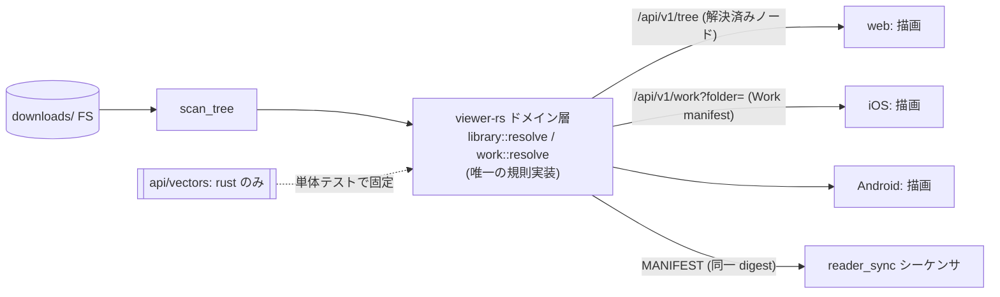

# サーバ解決型ドメインモデル — 「1 振る舞い = 4 実装」をやめる

> ステータス: **提案中** (#507) / ADR: [`docs/adr/0002-server-resolved-work-model.md`](../adr/0002-server-resolved-work-model.md)
> 対象: viewer-rs (Rust) / web (JS) / iOS (Swift) / Android (Kotlin) の全層。本書は提案のみで、コードは変更しない。

## 要旨

bookq の長期的な変更コストを決めているのは、性能でもフロントの巨大ファイルでもない。
**ドメイン規則 1 つを 4 つのランタイムで実装していること**である。

`/api/v1/tree` は「ファイルシステムの投影」(名前の木) しか返さない。そのため
「作品 (Work)」「章」「ページ」「棚 (階層)」「表紙」「可視性」という概念は、
各クライアントが木を解釈して**それぞれ再構築している**。`api/vectors/` の conformance
vectors (#280) は drift を検知する仕組みとしてよく効いているが、守っているのは
重複のほうであり、重複自体は減らさない。規則を 1 つ足すたびに、4 実装と vector 1 本が増える。

提案:

1. **ドメイン解決は viewer-rs だけが行う。** クライアントは解決済みモデルを描画する投影になる。
2. 第一歩として、サーバ内に**すでにある** Work マニフェスト (reader-sync の
   `build_manifest_core`: 章構成 + pageRefs + spreadTable + digest) を
   REST の一級リソース `GET /api/v1/work?folder=` に昇格させる。
   単独読書、オフライン保存、ペア読書の 3 経路が**同一 digest の同一成果物**を使うようになる。
3. 次に `/api/v1/tree` のノードへ解決済みフィールド (`path` / `coverUrl` / `kind` /
   可視性) を**加算的に**足し、クライアントから path の合成・分解・エンコード、表紙解決、
   隠しルート判定をなくす。
4. どれも v1 への加算的変更 (新 path、optional プロパティ、オプトインのパラメータ) なので、
   `api-breaking` に通り、App Store に残る旧 iOS バイナリやキャッシュ済み PWA シェル は壊れない。

---

## 1. 現状: ドメイン規則がどこに住んでいるか

### 1.1 ランタイム別の規模 (2026-11-15, `origin/main` f4d8ff7)

| ランタイム | 主な所在 | 行数 (概算) |
|---|---|---|
| viewer-rs (Rust) | `rust/viewer-rs/src/` + `rust/bookq-core/src/` | ~21.8k (うち `reader_sync/` ~4.7k) |
| web (JS) | `web/static/**/*.js` (vendor ディレクトリ除く) | ~17.7k (`app.js` 単体 5,206) |
| iOS (Swift) | `ios/Bookq/**/*.swift` | ~9.0k |
| Android (Kotlin) | `android/{core,data,app}/src/main` | ~14.4k (純ドメイン `:core` が 3,875) |

Android の `:core` は「純 Kotlin のドメイン規則」を集めたモジュールで、その中身は
ほぼすべてが web からの移植 (port) である (ファイル冒頭の `Port of web/static/...` /
`ported from app.js ...` / `Byte-faithful to iOS` コメント。iOS/Android の
`src/main` 内にこの種の注記は 28 箇所ある)。

### 1.2 規則ファミリ × 実装マトリクス

| 規則ファミリ | Rust (サーバ) | JS | Swift | Kotlin | 契約固定 |
|---|---|---|---|---|---|
| 作品構成 (兄弟 leaf → 章リスト) | `reader_sync/catalog.rs` `build_manifest_core` / `sibling_leaf_folders` | `app.js` `getSiblingLeafFolders` + `loadImages` | `ReaderModel.swift` `siblingLeaves` / `chapters` | `core/reader/ReaderWork.kt` | `work-chapters.json` (4 言語) |
| 章パディング + 見開き | `reader_sync/model.rs` `build_spread_plan` (**ペア専用**) | `viewer/spread.js` | `ReaderWork.assemble` | `ReaderWork.assemble` | `chapter-padding.json` / `solo-spreads.json` (**rust を含まない 3 言語**) |
| 合成 path → ノード解決 | `tree.rs` `find_tree_node` | `app.js` `findNodeByPath` / `findParentPath` | `BrowseModel.node(at:)` | `core/browse/BrowseRules.kt` | `path-lookup.json` |
| path エンコード / 画像 URL | `serve.rs` (デコード側) | `offline-core.js` `encodePath` / `imageUrl` | `API/ImageURL.swift` | `core/api/ImagePath.kt` | `encode-path.json` |
| 表紙解決 (`thumb` → `thumbs[0]`、平坦化 (flatten) 後のプレフィックス) | `tree.rs` (付与のみ) | `thumbs/resolveCover.js` | `Browse/FolderTileView.swift` | `core/browse/LevelModel.kt`, `ui/browse/CoverImage.kt` | なし |
| 隠しルートの可視性 (NFC+小文字化プレフィックス、フェイルクローズ) | `search.rs` (**search のみ**) | `browse/visibility.js` (738) | `Visibility/VisibilityStore.swift` (448) | `core/visibility/VisibilityRules.kt` (275) | なし |
| オフライン leaf 集約 (保存状態の親フォルダ集計) | — | `offline/storeAdapter.js` `getLeafPathsFor` / `_leafMost` | `Offline/OfflineStore.swift` | `core/offline/OfflineRules.kt` | なし |
| canonical JSON / manifest digest | `catalog.rs` `canonical` / `manifest_digest` | `viewer/pairClient.js` | `Sync/CanonicalJSON.swift` | `core/sync/CanonicalJson.kt` | `reader_sync_cases.json` (digest golden) |
| reader-sync クライアント状態機械 | (シーケンサはサーバ) | `viewer/pair*.js` + `browse/pairSync.js` (~4.9k) | `Sync/PairStore.swift` (891) ほか | `core/sync/PairStore.kt` (1,257) ほか | `reader_sync_cases.json` |

上の 9 ファミリのうち 8 つは 3〜4 ランタイムに実装がある。契約で固定されているのは 6 つ。
残りの 3 つ (表紙・可視性・オフライン集約) は「目で揃えている」だけである。

### 1.3 実際に起きている drift

いずれもリポジトリ内で確認できるもの:

- **章連結の深さゲート**: web は `SIBLING_AUTOLOAD_MIN_DEPTH = 2` で 深さ 2 の path の兄弟連結を止めるが、
  iOS はこのゲートを持たない。`android/core/.../ReaderWork.kt` の冒頭に
  「iOS drops that gate. Web wins.」と書かれている。同じ作品を開いても、
  web/Android と iOS で章の数が変わる。
- **iOS の章範囲クランプ漏れ**: `f38c31d fix(ios): clamp swipe/key turns to chapter range (web parity)`。
- **可視性の適用場所がそろっていない**: `/api/v1/search` はサーバ側で隠しルートを
  fail-closed で除外する (`search.rs`)。一方 `/api/v1/tree` は未フィルタで返し、
  web (`app.js:1442`)、iOS、Android がそれぞれ同じ述語でフィルタする。iOS は
  サーバ側で除外済みの検索結果をさらに `visibility.isVisible` で再フィルタしている
  (`SearchResultsView.swift:23`)。
- **表紙 URL の罠**: AGENTS.md §7 に「`thumb`/`thumbs` はフォルダ相対。prefix を付与しないこと」
  という注意書きがある。サーバが付与した相対パスを、クライアントが
  `_fullPath` と結合して URL を組み立てているため、この知識が全クライアントに漏れている。
- **単独読書とペアで見開き計算が 2 系統ある**: ペア読書の見開きはサーバの
  `build_spread_plan` が決める。単独読書の見開きは各クライアントの
  `spread.js` / `ReaderWork` が決める。両者を突き合わせる vector はない
  (`solo-spreads.json` / `chapter-padding.json` の `languages` に `rust` がない)。

### 1.4 根本原因

問題は個々の実装の質ではなく、**境界の位置**にある。

```mermaid
flowchart LR
  FS[(downloads/ FS)] --> SC[scan_tree<br/>平坦化 / 自然順ソート / サムネ]
  SC -->|"tree: 名前の木<br/>(FS の投影)"| W[web: 作品・章・見開き・表紙・可視性を再構築]
  SC --> I[iOS: 同上を再構築]
  SC --> A[Android: 同上を再構築]
  SC --> RS[reader_sync/catalog: 同上を再構築<br/>(ペア用 manifest)]
  V[[api/vectors/*.json]] -.差異 (drift) の検知.-> W & I & A & RS
```

ワイヤに出ているのは「ファイルシステムの形」で、「本の形」は出ていない。そのため
本の形を決める規則が、ワイヤの向こう側すべてに複製されている。vectors は
この構造を前提にした**補償制御**であり、規則が増えるたびに比例して増える
(コストはおおよそ 規則数 × ランタイム数)。

---

## 2. 提案するアーキテクチャ

### 2.1 原則

1. **ドメイン解決はサーバが一度だけ行う。** 作品構成・章・ページ順・見開き表・表紙 URL・可視性は viewer-rs の出力とする。
2. **クライアントは path を合成・分解・エンコードしない。** サーバが返した `path` / URL / `digest` を
   中身を解釈しない不透明な値 (opaque) としてそのまま使う (キャッシュキーもサーバ発行の URL 文字列そのものになるため、
   `encodePath` の一致保証が要らなくなる)。
3. **クライアントに残すのは、端末とビュー状態にしか依存しない計算だけ。**
   レイアウト、ジェスチャ、ズーム、ページモード / offset の選択、オフライン保存の機構、
   ペアのトランスポートと UI がこれに当たる。
4. **ワイヤは加算的に進化させる。** 新 path、optional プロパティ、オプトインのパラメータで進め、v2 は切らない。



### 2.2 リソース 1: Work マニフェスト — `GET /api/v1/work?folder=<path>`

`?folder=` を使うのは、既存の v1 (`/api/v1/images?folder=`、`reading-positions?folder=`)
と同じスタイルにそろえるためである。

レスポンス (案、`build_manifest_core` のコンテンツキーをベースにする):

```jsonc
{
  "kind": "work",
  "folder": "作品A/第1巻",            // 開いた folder (中身を解釈しない)
  "title": "第1巻",
  "digest": "sha256:…",              // reader-sync MANIFEST と同一の canonical digest
  "generation": 42,                  // tree generation (鮮度判定)
  "chapters": [
    {
      "name": "第1話", "folder": "作品A/第1巻/第1話",
      "pages": [
        { "name": "001.jpg", "url": "/image/%E4%BD%9C…/001.jpg", "thumbUrl": "/thumb/…/001.jpg" }
      ]
    }
  ],
  "spreadTables": { "0": [ … ], "1": [ … ] }   // offset 別の見開き表 (§2.4 の進行条件付き)
}
```

- **ETag = digest**。`If-None-Match` で 304 を返す。SW は `/api/` をすべて NetworkFirst で
  `bookq-api-v1` に入れる (`sw.js:287`) ので、追加の SW 変更なしでオンライン時のキャッシュが効く。
  エンドポイント定数は `api/endpoints.js` に自動生成 (codegen) される (#236)。
- **エラー**は reader-sync の manifest エラー (`ERR_NOT_FOUND` / `ERR_FORBIDDEN` / `ERR_BROKEN_ARCHIVE` /
  `ERR_EMPTY_WORK`、`catalog.rs` 冒頭の定数) を HTTP 404 / 403 / 422 に写す。コード文字列は reader-sync と共有する。
- **実装**は `reader_sync/catalog.rs` の `build_manifest_core` から、プロトコルに依存しない部分を
  `domain::work` に切り出し、WS の MANIFEST と REST の両方がこれを呼ぶ形にする。
  ロジックは新しく書かず、**既存実装を移動する**。

効果:

| 経路 | 現在 | 提案後 |
|---|---|---|
| 単独読書 (web) | tree から `getSiblingLeafFolders` → 章組み立て → `spread.js` | Work を取得して描画 |
| 単独読書 (iOS / Android) | `ReaderWork.siblingLeaves` / `assemble` | 同上 |
| オフライン保存 (web) | `getLeafPathsFor` → leaf ごとに `/api/v1/images` | Work 1 回で全ページ URL を得て、そのまま保存。IDB レコードは `digest` を持つ |
| ペア読書 | サーバが MANIFEST をチャンク配信し、クライアントが canonical JSON で digest を検証 | 同一 digest の Work をクライアントが HTTP で既に持っていればチャンク転送を省ける (Phase 5 の任意最適化) |
| 浅いツリー (shallow) モード (web) | 完全なツリーが届くまでオープンを `_pendingNav` に積む | Work は tree に依存しないので、すぐ開ける |

### 2.3 リソース 2: 解決済みライブラリツリー — `/api/v1/tree` への加算

ノードに次の optional フィールドを足す (旧クライアントは未知フィールドを無視するので互換が保たれる):

| フィールド | 意味 | 置き換わるクライアント規則 |
|---|---|---|
| `path` | 合成済みのフル path (平坦化 (flatten) 後の `parent/child` を含む) | `_fullPath` の構築、`findNodeByPath` / `BrowseModel.node(at:)` / `BrowseRules` のプレフィックス走査 |
| `coverUrl` / `coverUrls[]` | `/thumb/…` の絶対 URL (幅は `?w=` だけをクライアントが付ける) | `resolveCover.js`、各クライアントのサムネイルのプレフィックス結合 |
| `kind` | `"work" \| "shelf" \| "mixed"` (ドリルダウンの判定結果) | `hasOnlyImages` / `isMixed` / `drillsDown` |
| `work` | タップ時に開く Work の `folder` | 「どの folder を開くか」の判定 |
| `hidden` | `visibility=annotate` の時だけ付く | 隠しモード UI の表示 |

可視性はオプトインのパラメータで扱う。v1 の既定は未フィルタなので、既定は変えない:

- `visibility=apply`: 隠しルートをサーバで除外する。visibility の状態を読めない時は
  未フィルタの木を返さず 503 を返す (search と同じ フェイルクローズをサーバに寄せる)。
- `visibility=annotate`: 除外せず `hidden: true` を付ける (隠しモード・再表示 UI 用)。
- ETag には visibility のリビジョンを含める (隠す・再表示の操作で 304 が誤って返らないようにする)。

owner HMAC による書き込み (`PUT /api/v1/folder-visibility`) は今の仕組みのまま残す。
読み取り側の述語 (NFC+小文字化、プレフィックス、祖先判定) がクライアントから消える。

### 2.4 見開き表をサーバに寄せるかどうか (進行条件付き)

単独読書の見開き (`chapter-padding` → `solo-spreads`) と、ペアの `build_spread_plan`
(章ごとに offset、章をまたいだ見開きなし) が**同じ結果を出すかどうかは未検証の仮説**である。
パディング式 `pad = (startIdx - spreadOff + 2) % 2` は「各章の先頭を全体と同じパリティに
そろえる」もので、章単位で offset を適用するペア側と等価に見えるが、確認はしていない。

判定方法: `api/vectors/solo-spreads.json` と `chapter-padding.json` の `languages` に
`rust` を加え、`conformance_vectors.rs` から `model::build_spread_plan` で全ケースを流す。

- **全件一致**: `spreadTables` を Work に含める。クライアントの `rebuildSpreads` /
  `padChapterSpacers` / `ReaderWork.assemble` を削除する。
- **不一致**: どちらが正しい仕様かを先に決める (単独読書とペアで見開きが違うこと自体がバグ候補)。
  決まるまでは見開き計算をクライアントに残し、Work は章とページだけを返す。

### 2.5 クライアントに残るもの (非目標)

- 描画、ジェスチャ、ズーム、オーバービュー、タップゾーン判定 (`ZoomState.kt` などは端末依存で正当)
- ページモード / offset / 横向き見開きの**選択** (ビュー状態)
- オフライン保存の機構 (Cache Storage / IDB / iOS・Android のファイルストア)。ただし「何を保存するか」は Work が決める
- reader-sync のトランスポートとクライアント状態機械 (Phase 5 で別途判断する)

---

## 3. 移行計画

各 Phase は単独でマージでき、単独で切り戻せる。旧クライアントはどの時点でも壊れない。

| 段階 (Phase) | 内容 | 削除できるもの | 進行可否 |
|---|---|---|---|
| **0. 契約** | `openapi.v1.yaml` に `/api/v1/work` と tree ノードの optional フィールド、`examples:`、`v1-semantics.md` に §8 Work を追加。`solo-spreads` / `chapter-padding` に `rust` を追加 (§2.4 の判定) | — | `api-breaking` が緑、codegen-drift が緑、§2.4 の判定結果 |
| **1. サーバドメイン層** | `viewer-rs/src/domain/{work,library}.rs` を新設。`build_manifest_core` と tree の解決ロジックを移し、WS MANIFEST と REST の両方から呼ぶ。`main.rs` (1,949 行) から ルートハンドラをドメイン別に移す | — | 既存の reader-sync テスト / golden / digest が無変更で緑。Schemathesis が新エンドポイントで緑 |
| **2. web** | `loadImages` と `downloadWork` を Work 経由に置き換える。IDB の作品レコードに `digest` を持たせる | `getSiblingLeafFolders`、章組み立て、`getLeafPathsFor` の leaf 列挙 (§2.4 の判定が進行可なら `spread.js` の計算部も) | `perf-measurement` で「タップ → 1 ページ目表示」が非悪化 (§5.1)。オフライン系 pytest と iOS シミュレータの PWA 確認が緑 |
| **3. iOS / Android** | `ReaderModel` / `ReaderWork` を Work 経由に置き換える | `siblingLeaves` / `assemble` / `chapters`、`work-chapters.json` が rust のみになる | `BookqTests` / `:core:test` / UI テストが緑。実機確認 (ios-device-deploy、CP08-J1) |
| **4. 解決済みツリー + 可視性** | tree の新フィールドと `visibility=apply\|annotate` を 3 クライアントが使う | `resolveCover.js`、path 合成とルックアップの 3 実装、`VisibilityRules` / `VisibilityStore` / `visibility.js` の読み取り述語、`path-lookup.json` / `encode-path.json` のクライアント側 | 隠しルートの pytest (専用 `BOOKQ_STATE_DIR`) が緑。fail-closed がサーバで成り立つこと |
| **5. 判断点: ペア** | Phase 4 後に残る重複 (reader-sync クライアント状態機械 ×3) を計測し、(a) vectors で維持、(b) Rust リデューサーを UniFFI / wasm で共有、のどちらにするか ADR で決める。任意の最適化として、Work digest で MANIFEST のチャンク転送を省く | 判断次第 | §6 B の前提条件 |

順序の理由: Phase 1 は「既存ロジックの移動」なのでリスクが最も低い。Phase 2 は最大のクライアント
(web、`app.js` 5,206 行) の重複を最初に外す。Phase 4 は旧クライアントとの共存期間が最も長い
(可視性の意味論が絡む) ので最後に回す。

---

## 4. 成功指標

| 指標 | 現在 | 目標 |
|---|---|---|
| `api/vectors/*.json` のうち `languages` が `["rust"]` 以外のもの | 5 / 6 | 0〜1 (`encode-path` を URL 生成の契約としてだけ残す可能性がある) |
| 契約固定のないクロスランタイム規則ファミリ (§1.2) | 3 (表紙・可視性・オフライン集約) | 0 |
| 1 つのドメイン規則変更で触るランタイム数 | 3〜4 | 1 (+ 必要なら描画側) |
| 「parity」「web wins」系の修正コミット | 継続的に発生 | Phase 3 以降は新規 0 |
| タップ → 1 ページ目表示 (web / iOS / Android) | `docs/performance.md` 基準 | 非悪化 |

---

## 5. リスクとトレードオフ

### 5.1 作品を開く時に 1 RTT 増える (最大のトレードオフ)

いま web は、完全なツリーが手元にあれば**リクエスト 0 回**で作品を組み立てる
(`loadImages` は tree の子から章を作り、`/api/v1/images` はフォールバックでしか呼ばない)。
Work 取得はこれに直列の 1 RTT を足す。緩和策:

- 1 ページ目の URL はタイルが既に知っている (`work` と表紙ノード) ので、Work 取得と
  1 ページ目の画像取得を並行して始める。
- ビューポート内のタイルについて、アイドル時に Work を先読みする (`thumbs/prefetch.js` と同じ枠組み)。
  ETag があるので再訪時は 304 で済む。
- Phase 2 の Go 条件を「`perf-measurement` で非悪化」にして、実測で判断する。

### 5.2 オフライン

- **ダウンロード済みでない作品**はオフラインでは元々読めない (グレータイル)。ここは何も失われない。
- **ダウンロード済みの作品**は、`downloadWork` が Work JSON を IDB レコードに明示的に保存する。
  SW の API キャッシュ (NetworkFirst) は共有のベストエフォート なので、それに頼らない。
- オフラインのブラウズは今どおり tree スナップショットを使う。Phase 4 の解決済みフィールドは
  tree に入るので、スナップショットにもそのまま入る (クライアント側で再計算しない)。

### 5.3 旧クライアントとの共存

すべて加算的なので、旧 iOS バイナリ / 旧 PWA シェルは今の規則のまま動き続ける。
**旧クライアントのコードは消せない**が、それは新クライアントの側から削るだけで、
サーバ側の旧経路 (tree の既定、`/api/v1/images`) は v0 退役 (#212) と同じ手順で後から引退させる。

### 5.4 サーバへの依存が強まる

viewer-rs は既に単一の本番バックエンドで、ペア読書の manifest も既に作っている。
新しく増える責務は「同じものを REST でも出す」ことだけである。tree は
`/api/v1/tree` の generation で管理されたインメモリのデータなので、Work 解決の
追加コストは小さい見込み (Phase 1 で計測する)。

### 5.5 path を ID として使い続けること

読書位置、オフラインキャッシュ名、ペアの `folder` はすべて path をキーにしているため、
ディスク上でリネームすると切れる。本提案ではここを**解決しない**。ただし原則 2
(path を不透明な値として扱う) を守れば、将来サーバ側で安定 ID に切り替えてもクライアント側の
変更が最小になる。

---

## 6. 検討した代替案

| # | 案 | 評価 | 結論 |
|---|---|---|---|
| A | **現状維持 + vectors 拡充** | 安く、今すぐできる。ただしコストは規則数 × ランタイム数のままで、vectors は書いたケースしか守らない (深さゲートの drift は vector 化される前に起きた) | 不採用。ただし Phase 0 の §2.4 判定には使う |
| B | **Rust 共有クライアントコア** (`bookq-core` を UniFFI で Swift/Kotlin、wasm-bindgen で web に配る) | 純粋関数の drift はゼロになる。一方で、(1) web の「ビルドステップなし」と SW `SHELL_ASSETS` の契約に wasm 成果物が入る、(2) CI に FFI ツールチェーンが 3 系統増える (iOS は xcode-27 プレビューランナー、Android はエミュレータ)、(3) 重複コードの大半は純粋関数ではなく、各プラットフォームのリアクティブ状態 (SwiftUI の ObservableObject、Kotlin の StateFlow、JS のイベントループ) に絡んでいる、(4) 「クライアントが FS の投影を解釈する」という境界はそのまま残る | 今は不採用。Phase 5 で reader-sync のリデューサーだけに絞った候補として再評価する |
| C | **web フロントの ESM 化 / `app.js` 分割** | 価値はあるが web だけの改善で、クロスランタイムのコストは減らない。Phase 2 で `app.js` からドメイン規則が抜けた後のほうが分割対象が小さくなる | 本提案の後に行う |
| D | **viewer-rs の層整理** (`main.rs` 1,949 行の ルーティングとハンドラの分離) | 衛生面の改善としては妥当だが、単独では効果が小さい | Phase 1 に含める |
| E | **安定コンテンツ ID** (リネームに強い識別子) | 長期的には価値がある。ただし変化するファイルシステム上で永続的な ID 対応表が要り、読書位置の移行も伴う | 見送り。原則 2 で将来の導入を容易にしておく (§5.5) |

---

## 7. 未決事項

1. `spreadTables` を含めるかどうか (§2.4 の判定結果による)。
2. `/api/v1/work` を `folder` の代わりに tree の `path` で引けば十分か (平坦化 (flatten) 済み名を含む path を
   `?folder=` が受けられるかは、`find_tree_node` の既存挙動で確認する)。
3. Work に `metadata` (タイトル、作者など。index 由来) を含めるか。含めると facets / search の結果表示と
   統一できるが、index 構築中 (202) の扱いが Work にも波及する。
4. Android / iOS のオフラインストアで Work JSON をどこに保存するか (Room / ファイル / UserDefaults)。

## 付録: 根拠の参照先

- サーバの manifest 解決: `rust/viewer-rs/src/reader_sync/catalog.rs` `build_manifest_core` / `chapter_pages`
- サーバの見開き: `rust/viewer-rs/src/reader_sync/model.rs` `build_spread_plan`
- web の作品組み立て: `web/static/app.js` `loadImages` (~L2308) / 可視性フィルタ L1442
- 深さゲートの drift: `android/core/src/main/kotlin/dev/bookq/core/reader/ReaderWork.kt` 冒頭の KDoc
- 可視性の二重フィルタ: `ios/Bookq/Browse/SearchResultsView.swift:23`、`rust/viewer-rs/src/search.rs` `hidden_roots`
- SW の API キャッシュ: `web/static/sw.js:287`
- 契約運用: `api/README.md` (加算的変更のみ、`api-breaking` CI)
